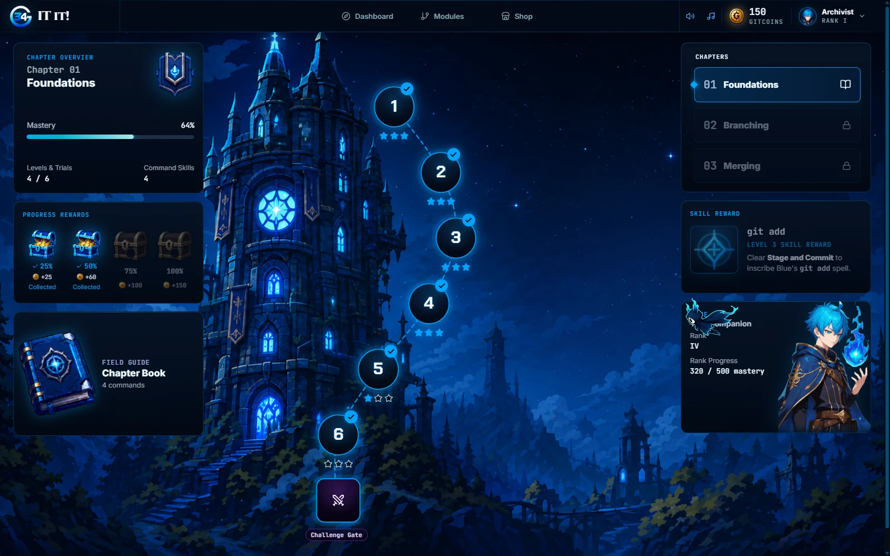
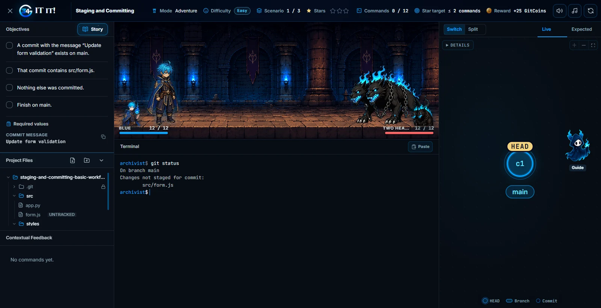
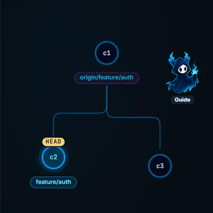
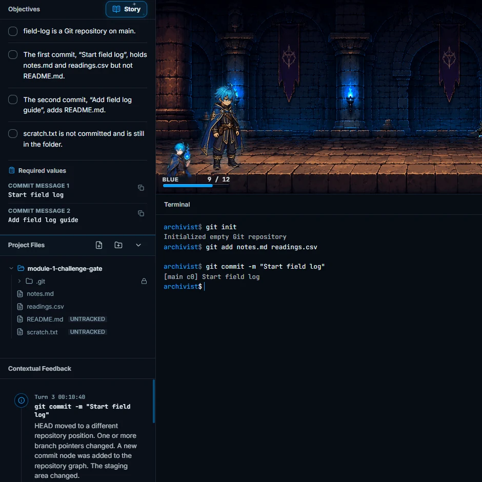
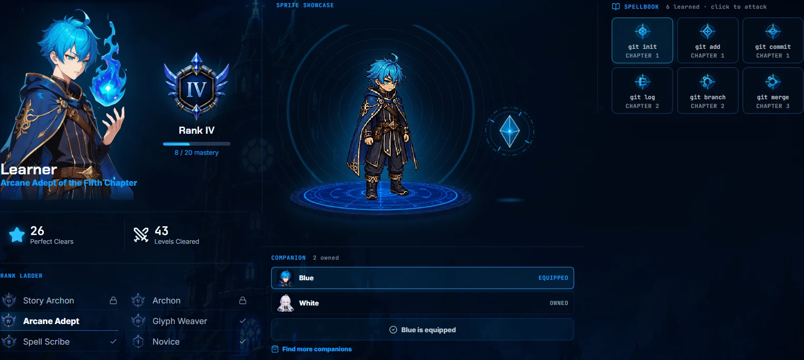
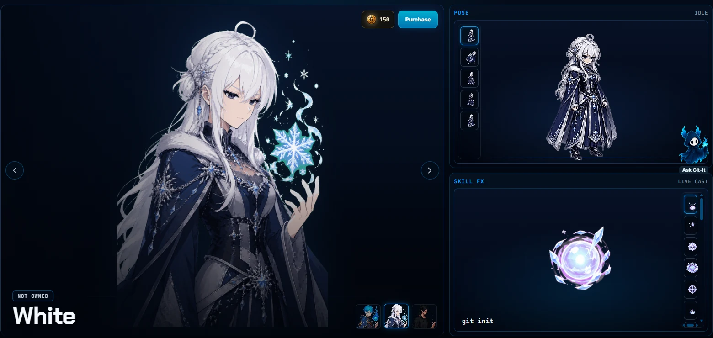
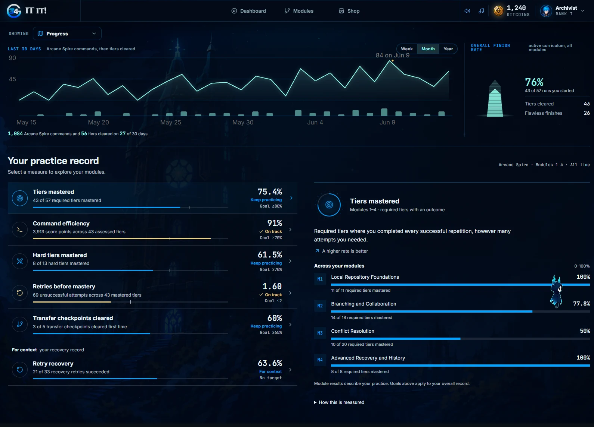

<div align="center">

# GIT it!

### Learn Git. Cast commands. Climb the Spire.

A fantasy adventure built around practical Git problem-solving.<br>
Practice in a simulated terminal, watch your repository take shape, and earn your way forward.

[Explore the features](#inside-the-spire) · [Run locally](#run-locally) · [Architecture](ARCHITECTURE.md) · [Deployment](DEPLOYMENT.md)

**React + TypeScript** &nbsp; / &nbsp; **Django REST Framework** &nbsp; / &nbsp; **State-based evaluation**



*Your learning path, rendered as a world worth exploring.*

</div>

## Inside the Spire

Git makes more sense when you can see what a command changes. GIT it! turns repository problems into playable scenarios: read the situation, try a command, inspect the result, and work toward the target state. The practice environment is simulated, so you can experiment freely.

### Commands become combat

Adventures pair Git scenarios with animated encounters. Your companion fights as you work through repository objectives, with immediate terminal feedback and a live view of the repository. Guidance fades from **Easy → Medium → Hard**, giving you more room to solve each scenario independently.



### See the state. Solve the problem.

<table>
  <tr>
    <th width="50%">A repository you can read</th>
    <th width="50%">A challenge you can reason through</th>
  </tr>
  <tr>
    <td></td>
    <td></td>
  </tr>
  <tr>
    <td><strong>Live repository graph.</strong> Follow commits, branches, and HEAD as commands change the repository.</td>
    <td><strong>Independent trials.</strong> Reach the required repository state; completion checks evaluate the result.</td>
  </tr>
</table>

- **Learn before you leap.** Orientation lessons, chapter field guides, and a searchable command library put Git concepts within reach.
- **Practice recall.** Squire's Drill reinforces command knowledge before you return to scenario practice.
- **Make retries count.** Structurally changed scenario variants encourage you to understand the problem beyond a memorized command sequence.
- **Earn verified progress.** The frontend responds immediately; the backend verifies command transitions, completion, and rewards before saving them.

### Build your spellbook. Choose your companion.

Git skills become part of your spellbook. Earn GitCoins through progress, collect chapter chests, and choose a companion from the Armory. Your profile brings together your character, rank, learned commands, and achievements.

<table>
  <tr>
    <th width="50%">Your companion &amp; spellbook</th>
    <th width="50%">The Armory</th>
  </tr>
  <tr>
    <td></td>
    <td></td>
  </tr>
</table>

### Watch your understanding grow

The dashboard connects recent activity, chapter progress, skill mastery, and practice results. See what you have cleared and where to practice next.



<sub>Screenshots captured from the running application with a disposable local demo account and built-in preview fixtures. Some views are cropped to highlight individual features.</sub>

## Run locally

Use **Python 3.13**, **Node.js 22**, and **npm 10**. The development configuration supports SQLite; production configuration and services are covered in the [deployment guide](DEPLOYMENT.md).

For a fresh checkout, start the API in one terminal:

```powershell
cd backend
Copy-Item .env.development.example .env
python -m venv .venv
.venv\Scripts\Activate.ps1
pip install -r requirements-dev.txt
python manage.py migrate
python manage.py seed_all
python manage.py runserver
```

Start the frontend in a second terminal:

```powershell
cd frontend
Copy-Item .env.example .env
npm ci
npm run dev
```

Open **[localhost:5173](http://localhost:5173)** and create an account. The API runs at **[localhost:8000/api](http://localhost:8000/api/)**. Use the same hostname for both services so authentication cookies work consistently.

<details>
<summary><strong>macOS / Linux activation</strong></summary>

Use `cp` in place of `Copy-Item`, and activate the environment with:

```bash
source .venv/bin/activate
```

</details>

`seed_all` upserts the current Arcane Spire curriculum, command library, and drills while preserving player progress. To seed the curriculum alone, run `python manage.py seed_curriculum` from `backend/`. The retired `seed_curriculum_fixture` is disabled outside isolated tests.

## Under the hood

The project has two applications: a **React + Vite** single-page frontend and a **Django + Django REST Framework** API.

```text
frontend/src/
  app/              Router, layouts, and providers
  features/         Adventures, challenges, story map, shop, and dashboards
  shared/           API, auth, battle, cosmetics, simulator, and UI utilities
  styles/           Design tokens and feature styles

backend/
  common/           Shared schemas, command boundary, and utilities
  simulator/        Git state normalization and parity helpers
  evaluation/       State-based objective evaluation
  adventures/       Adventure runtime and services
  challenges/       Independent trial runtime and services
  practice/         Command execution services
  curriculum/       Authored and generated learning content
  shop/             Companion catalog, ownership, and equipment
  progress/         Completion records, rewards, and learning statistics
```

### How a command becomes progress

```text
Enter a command
  → Frontend simulator gives immediate visual feedback
  → Frontend submits the command and proposed next state
  → Backend validates the payload and verifies the transition
  → Verified completion and rewards are persisted
```

The backend owns persisted state, reward decisions, command integrity, schema validation, semantic slugs, and API contracts. The frontend owns presentation, animation, optimistic command feedback, and visual asset resolution. See [ARCHITECTURE.md](ARCHITECTURE.md) for the complete ownership and import rules.

<details>
<summary><strong>Product vocabulary & contributor conventions</strong></summary>

| Term | Meaning |
| :--- | :--- |
| Story | A learning path |
| Chapter | A section within a story |
| Lesson | Short conceptual reading |
| Adventure / Scenario | Guided battle-style practice |
| Challenge / Trial | Independent state-based practice |
| Level map | Visual chapter navigation |
| Story world | The visual bundle for a story and its map |
| Companion | The player's battle/avatar cosmetic |

Current URLs are defined in `frontend/src/shared/navigation/routes.ts`. The active story opens at `/stories/arcane-spire`. Retired URL aliases are removed rather than redirecting into unrelated pages.

Feature folders use `api/`, `components/`, `hooks/`, `pages/`, `types.ts`, and `utils/` as needed. Shared modules must not import feature modules; non-page feature modules must not import feature pages. Django views parse requests, call services, and return responses. Business logic belongs in services and helpers with focused tests.

Backend runtime code must not inspect frontend source or visual assets. Generated data must document how it is regenerated. Runtime API wrappers must use the generated API contract helper.

</details>

## Validation

Run these from the repository root for the fast guard suite:

```bash
python scripts/check_quality_gates.py
python scripts/check_repository_artifacts.py
```

<details>
<summary><strong>Frontend & backend checks</strong></summary>

Backend, from `backend/` with its virtual environment active:

```bash
ruff check .
python -m pytest -q
```

Frontend, from `frontend/`:

```bash
npm run api:check
npm run api:usage-check
npm run api:type-adoption-check
npm run lint
npm run lint:dead
npm test
npm run build
```

Individual guards, from the repository root:

```bash
python scripts/check_legacy_terms.py
python scripts/check_architecture_boundaries.py
python scripts/check_css_architecture.py
python scripts/check_seed_targets.py
python scripts/check_api_contract.py
python scripts/check_frontend_api_usage.py
python scripts/check_api_type_adoption.py
python scripts/check_documentation_current.py
python scripts/check_ci_quality_gates.py
python scripts/check_django_deploy.py
```

After installing frontend dependencies, verify generated targets with:

```bash
python scripts/check_generated_targets_current.py
```

</details>

<details>
<summary><strong>Command latency profiling</strong></summary>

Profiling is opt-in and uses disposable pytest data. From `backend/`, run the two cold probes in separate processes, followed by the warmed lanes:

```powershell
$env:COMMAND_LATENCY_SAMPLES='15'
python -m pytest scripts/profile_command_latency.py::test_profile_adventure_cold -q -s
python -m pytest scripts/profile_command_latency.py::test_profile_challenge_cold -q -s
python -m pytest scripts/profile_command_latency.py::test_profile_steady_state -q -s
```

Set `COMMAND_LATENCY_REVERSE_LANES=true` for the order-control run. Wall-time results are machine-local evidence, not CI thresholds.

</details>

## Project guides

| Guide | What you will find |
| :--- | :--- |
| [Architecture](ARCHITECTURE.md) | Domain contracts, ownership, import boundaries, and testing strategy |
| [Content authoring](CONTENT_AUTHORING_GUIDE.md) | Learning content, scenarios, and generated targets |
| [Design system](DESIGN.md) | Visual identity, tokens, typography, and components |
| [Product](PRODUCT.md) | Audience, purpose, and product principles |
| [KPI methodology](KPI_METHODOLOGY.md) | Definitions behind learning and performance metrics |
| [Deployment](DEPLOYMENT.md) | Production setup, migrations, TLS, smoke tests, updates, and rollback |
| [Render](deploy/RENDER.md) · [Vercel](deploy/VERCEL.md) | Hosting walkthroughs for the API and frontend |

<details>
<summary><strong>Package a clean source archive</strong></summary>

From the repository root:

```powershell
python scripts/clean_repository_artifacts.py
python scripts/check_repository_artifacts.py
python scripts/package_source_zip.py git-it-clean.zip
```

</details>
